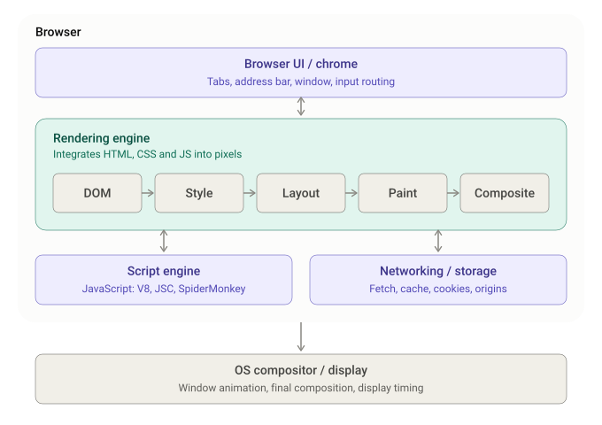
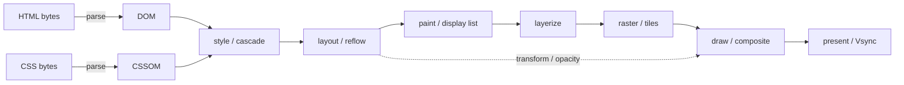
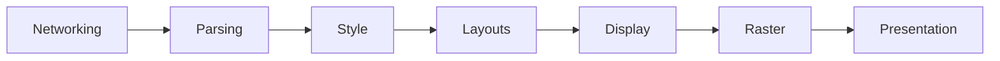
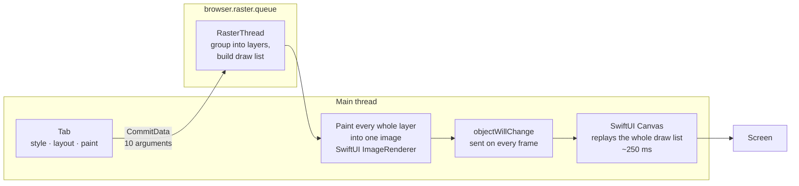
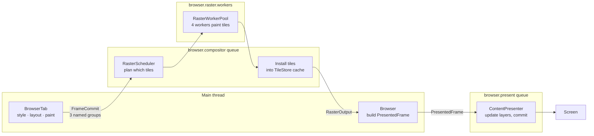
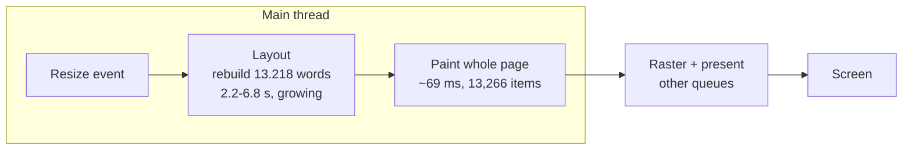

> **Note:** This post involves the AI intervention, but I have personally reviewed it. 

## Preface

Today, we have a lot of web browsers. Start from Google Chrome, Firefox, Safari, Microsoft Edge, Brave, Opera, and maybe many more. If we take a look closer, some of these browsers use the same engine. Example: Microsoft Edge, Brave, and Opera use the Google Chrome's engine. Now, let's take a look deeper about engine inside the browsers. Here's the list:

- Blink: Google Chrome, Microsoft Edge, Brave, and Opera
- Gecko: Firefox
- WebKit: Safari

These engines are rendering engine. Those rendering engines above are mostly written with C/C++. Few years ago, there is another rendering engine called Servo written with Rust. Recently, we also have a new web browser called Ladybird. This browser has rendering engine called LibWeb written with Rust too.

> Should I add "I hate Rust." and "Rust is amazing." here? IYKYK.

Now, the question is: what is rendering engine? It's an engine to turn web page into pixel on the screen. In this post, I will discuss deeper about rendering engine, it's responsibilities, and some challenges I'm facing on in rendering engine.

But first, let me show you the simple anatomy of browser.

## Anatomy of Browser



Here's how to read it, from the outside in:

- **The shell (Browser, Chrome, Tab, Frame, Viewport)**. The `Browser` holds the `Chrome`, which is the browser's own interface (address bar, tab strip, buttons), plus one or more `Tab`s. Each tab loads a page into a `Frame`. An iframe on the page creates another nested frame. The `Viewport` is the part of the frame you can actually see and scroll.
- **The layout tree (the teal boxes)**. `DocumentLayout` is the root. Under it, `BlockLayout` nodes stack vertically and can contain other blocks. When a block holds text, it splits that content into `LineLayout` rows.
- **Inline content**. I drew `InlineLayout` as the group of things that sit inside a line. There are kinds of leaf: `TextLayout` for words and `EmbedLayout` for non-text items like images, inputs, and iframes.

## Parts of Browser

A browser is more than its engine.



Here's how to read it, from top to bottom:

- **Browser UI / chrome** is the only part you see directly. It takes your clicks and typing and passes them down to the page in the current tab.
- **Rendering engine** is the core. It turns a page into pixels in five steps: build the DOM, work out styles, lay out the boxes, paint them, then hand the layers off for compositing. The layout tree from the first diagram (`DocumentLayout` -> `BlockLayout` -> ...) is what Layout step builds.
- **Script engine and networking / storage** are separate parts the rendering engine calls on. Scripts read and change the DOM. The network loads the HTML, CSS, images and scripts, and applies cache, cookie and origin rules.
- **OS compositor / display** sits outside the browser. The operating system combines the browser's layers with every other window and shows the result on screen at the display's refresh rate.

## Rendering Engine

Let's fill our knowledge about rendering engine.

What is rendering engine? It's an engine to turn the web page into pixel on the screen.

These orders are a whole process of rendering engine.



- **Parse HTML (bytes -> DOM)** HTML bytes from the network are decoded into text, split into tokens, and then assembled into a DOM tree. The parser also fixes the broken HTML, for example by put `<tbody>` or closing tags `</tbody>` into `<table>` tag that were left open.
- **Parse CSS (bytes -> CSSOM)** CSS bytes from (`<style>`, `<link>`, or the `style` attribute) are parsed into a list of rules made up of selectors and declarations, called the **CSSOM**. This happens in parallel with building the DOM.
- **Style** (style calculation): combines the DOM and the CSSOM. The browser matches every selector against the DOM nodes, then computes each element's final *computed style* (cascade, inheritance, specificity). The result: every node knows its `color`, `display`, `font-size`, and so-on.
- **Layout** (reflow): computes **geometry**. It means the x/y position, width and height of every box, based on the box model, flexbox, grid, and text wrapping. The result is a *layout tree* or *fragment tree*.
- **Paint**: builds a **list of drawing commands** (a *display list*), for example "draw a red box at (10, 20)" followed by "draw the text 'Hello' on top of it". There are no pixels yet at this stage, only instructions in the correct z-order.
- **Layerize**: splits the display list into multiple **layers**. Elements with `transform`, `opacity`, `will-change`, `video`, or scrolling areas usually get their own layer. The goal is that a change to one layer doesn't force the other layers to be redrawn.
- **Raster**: executes the display list of **each layer** into actual pixels (a bitmap). This work is usually split into *tiles* and often done on the GPU.
- **Draw / Composite**: the compositor **assembles the already-rasterized layers** into one final frame, applying transform, opacity, and scroll position along the way. This usually runs on separate thread or on the GPU. `transform` and `opacity` animations can jump straight to this stage without repeating layout, paint, and raster.
- **Present**: the final frame is sent to the screen, synchronized with **Vsync** (the monitor's refresh rate, e.g. 60 Hz ≈ 16 ms per frame) to prevent *tearing*.

## Rendering Engine Responsibilities

Rendering engine has lot of responsibilities. Here's the list:

- **Frame scheduling**: decides when to make a new frame (the "rendering loop" or "even loop"), at most once per Vsync. It groups many changes into one frame and runs `requestAnimationFrame` callbacks before style and layout.

- **Scrolling**: moves the viewport over content that's already laid out. A good engine scrolls in the compositor by shifting the layer, without new layout or paint. That's why scrolling can stay smooth while the main thread is busy.

- **Viewport/resize handling**: when the window size changes, layout runs again for the new width, then paint and raster. This is **the most expensive path**, so it has to be throttled to the frame rate.

- **Invalidation (incremental updates)**: tracks what is "dirty" after a change (DOM edit, style change, resize) and redoes only that part of style, layout, or paint instead of the whole page.

- **Hit testing and input events**: turns a click, tap, or key press at (x, y) into the right DOM element using layout tree. It then dispatches the event (`click`, `input`, focus, link navigation).

- **Script integration (DOM bindings)**: gives the script engine an API to read and change the DOM (`querySelector`, `innerHTML`, event listeners). Every change feeds back into invalidation. The JS engine runs the code; rendering engine owns the DOM it touches.

- **Text and fonts**: load fonts, measures text, and shapes and breaks it into lines during layout.

- **Animations and visual effects**: handles `transform`, `opacity`, blending, clipping, and CSS transition, running them in the compositor when possible.

- **Embedded content**: decodes images and lays out and paints `<iframe>`s as nested documents with their own frames.

- **Accessibility tree**: builds a parallel tree from the DOM and layout so screen readers can read the page.

- **Security boundaries**: enforces same-origin rules for scripts and iframes, together with networking layer.

In this post, I will discuss about the two hard things I'm facing on in rendering engine: scrolling and resize handling.

## Why Swift?

1. I'm using macOS. It's ridiculous if I never touch Swift programming language when I'm using macOS. Although, I'm using base model of MacBook Air M1, it should not be a gap to prevent me to use this language.

2. Saving my time with GUI (Graphical User Interface). In the end, the browser used by end-user is a desktop application. By using macOS and Swift, I have access to Apple GUI library like AppKit and Swift.

3. Trying something new and curiosity. Previously, I mentioned about Ladybird. It's a new web browser written by scratch and truly independent. The truly independent means no interference from hands of giant corporations like Google. In 2024, the LadyBird team trying to replace C++ with Swift. But, the experiment failed because Swift support for C++ interopt doesn't meet their expectation and platform support outside Apple ecosystem was limited. That's why they pick Rust. So, here I go to try it again and who knows I learn things. :D

## Starting Point

I have follow along the practical guide from Browser Engineering and it turns to be a repository called Brownie (Browser Engineering). It used Python programming language based on the book. I start it from October 2025 and finish it in April 2026.

When I'm porting the code program into Swift, I split it into 4 parts (branches):

- Part 1 - branch `ch01-10`: It covers Downloading Web Pages to Keeping Data Private
- Part 2 - branch `ch11-14`: It covers Adding Visual Effects to Making Content Accessible
- Part 3 - branch `ch15`: It covers Supporting Embedded Content
- Part 4 - branch `ch16`: It covers Reusing Previous Computation

Of course I'm using AI. For part 1 and 2, I use Claude Sonnet and Opus as assistance. For part 3 and 4, I use Deepseek v4.1 Flash but later on I'm back to Claude Opus.
Instead of AI write the code, I write the code generated by AI. Why? At least I want to make an effort to learn the syntax and behavior of Swift because I'm newbie in Swift programming and browser engineering. Of course, I prohibit myself to put any Swift third-party dependencies to build the rendering engine. :)

## First Challenge: Smooth Scrolling

Given video side by side: the left side is bad scroll (before fix) and the right side is good scroll (after fix).

<lite-youtube videoid="LfeJ1Hru42s" title="Bad Scroll vs Good Scroll"></lite-youtube>

Let's illustrate the bad scroll pipeline into a interactive animation.

<script type="module" src="/rendering-engine/bad-scroll-pipeline.js"></script>
<bad-scroll-pipeline>
    <p><em>Interactive diagram of the scroll pipeline (needs JavaScript).</em></p>
</bad-scroll-pipeline>

Why is it slow?

1. **The main thread does almost everything**. Four of the five boxes run on it, and it also reads your trackpad. `RasterThread` only builds the draw list; the actual painting goes back to the main thread. So while the main thread draws, your scroll events wait.

2. **Scrolling far repaints the whole page**. The engine only paints 2400 px around what you see. Leave that area and `Tab` lays out and paints the *entire page* again, and `ImageRenderer` repaints every layer. Each time, the screen freezes for about 470 ms. In the trace this happened 34 times, the screen was **frozen for 15.9 s out of 30.6 s** of scrolling. That's the stutter in the video.

3. **Nothing is reused**. Each layer is painted as one big image instead of tiles, so even a small scroll can't reuse pixels that are already implemented.

4. **SwiftUI redraws all the time, and slowly**. The `objectWillChange` fires on every frame, even when the page is standing still (60 frames per second of nothing). Each redraw makes `Canvas` replay the whole draw list. Before the fix in `eb5cd01`, that took about 250 ms, or about 4 updates per second, while 60 Hz frame has about 16 ms.

**Also: scrolling ignores your fingers**. Every wheel event moves the page exactly 100 px and restarts the animation, however fast you swipe.

**In short**: the main thread repaints the entire page from scratch, even when you only scroll a few pixels.

## Refactoring Smooth Scrolling

The bad scroll experience is one of result from vibe coding where you don't set the safety rails and accept every output from the model. Imagine you see kraby patty but when you eat it the taste like chumb bucket. YIKES!

To fix this problem, I stepped back and took a look at the code. The first thing I noticed was that the rendering engine was mixed up with SwiftUI: 10 files in the engine did `import SwiftUI`. My intuition said that if I made the rendering engine free from SwiftUI, finding the culprit would be much easier.

### Separate Rendering Engine from SwiftUI

I put the two rules: 

1. The rendering engine must be free from SwiftUI. 
2. Make protocol to make rendering engine and SwiftUI communicate each other.

I introduced small protocol called `Renderer`. It has contract for fill a rect, draw text, save/restore state. Then, I make two implementations based on `Renderer` protocol: `CGRenderer` (Core Graphics, inside `Engine` directory) and `SwiftUIRenderer` (inside the app).

Thanks to this one change, now it unlocks to things:

1. **A headless browser CLI (`10e4fcd`)**. The engine can render a page to PNG with no window. Now I can *look* a frame without clicking around.
2. **The browser chrome moved out (`57a024e`)**. The address bar and tabs bar are app code, not engine code. Removing the `import` only split the engine from the UI framework; moving `Chrome` split it from the UI *logic*.

### Scroll Bugs Become Readable

Thanks to the first step, now the scroll code become readable. There are three problems: the two problems were there from the start; the third one caused by myself during the cleanup.

**The UI was redrawing for nothing**. Every frame told SwiftUI "something changed", even when nothing did. SwiftUI then re-ran the whole page drawing (~250 ms) and the main thread was stuck at about 4 visible updates per second ([`eb5cd01`](https://github.com/kresnasatya/ToyStack/commit/eb5cd0132a2866e0bc3dc158286c4f8551d5cabe#diff-5329dfe88160bce2fcb345f233dbcc30bd1dc5c1dc91e779c174b7ef54652ede)). The fix was only signal a change when the painted output actually changed.

**Scrolling ignored the trackpad**. Every wheel event moved the page a fixed 100 px and restarted a scroll animation. Now the real trackpad delta is used, and scrolling inside a scroll container repaints without running style and layout (`64cea66`).

**The cleanup broke scrolling**. Before the cleanup, `Transform` moved the drawing by `+t`, drew its children, then moved back by `-t`. When it switched to `Renderer` protocol (`2242392`), it replaced that pair with save/restore, and got it wrong:

```swift
if let t = translation {
    renderer.saveState()
    renderer.translateBy(x: t.x, y: t.y) // only saves when there's a CSS transform
}

// ...draw children...
renderer.restoreState() // but always restore
```

`saveState()` writes down the current shift, and `restoreState()` puts back the newest one written down, no matter who wrote it.

Every tag on the page is drawn by its own `Transform`, and most tags have no CSS transform. So what happens when one of them calls `restoreState()`? step through it:

<script src="/rendering-engine/transform-leak-demo.js"></script>
<transform-leak-demo></transform-leak-demo>

The `<h1>` saved nothing, but its restore still ran and put back the 0px that the scroll loop had written down. The scroll was gone, and every tag after `<h1>` was drawn as if the page weren't scrolled. The scrollbar still looked right because it uses the scroll number, not the shift, so the bug was easy to miss.

The fix moves one line, so every restore has its own save (press **B** in the demo to replay it with the fix):

```diff
+ renderer.saveState()
  if let t = translation {
-     renderer.saveState()
      renderer.translateBy(x: t.x, y: t.y)    
  }
```

> **Note:** Actually this bug never happen if I put a test for `Transform` with no CSS transform.

### Too Much Arguments

The first scroll fixes worked, but they piled more arguments onto already crowded functions:

```swift
func rasterIfNeeded(scale: CGFloat, store: TileStore, hintTop: CGFloat, hintBottom: CGFloat, visibleTop: CGFloat, visibleBottom: CGFloat, budget: RasterBudget, visibleOnly: Bool = false)
```

Oh, there's also a class called `CommitData`, the data a tab hands over to the browser for every frame. It started this story with 10 arguments. My own scroll fixes added three more: `paintEpoch` (`eb5cd01`), `layoutHeight` (`1a1a0c0`) and `maxScroll` (`e5ca898`). That made 13:

```swift 
class CommitData {

    init(
        url: WebURL, scroll: CGFloat, height: CGFloat, layoutHeight: CGFloat, 
        maxScroll: CGFloat, displayList: [Any],
        compositedUpdates: [ObjectIdentifier: VisualEffect]?, 
        accessibilityTree: AccessibilityNode?,
        focus: DOMNode?, interestTop: CGFloat, 
        paintEpoch: Int, prefersDark: Bool, forcedColors: Bool,
    ) {}
}
```

I paused for a moment and then I say "What the hell!?"

First, `rasterIfNeeded` takes 8 arguments and `CommitData` takes 13.
Second, if I keep going, it will be more messing up. 
Third, I don't know which of these values belongs to.

So I set a rule (`d348182`): **a function takes at most 4 parameters, and a struct has at most 4 stored properties.**

> Psst... This idea come from declaration of margin and padding in CSS. The margin and padding have 4 properties: top, right, bottom, left.

Thanks to this approach, for `rasterIfNeeded` the four edges became one `RasterWindow` (`d348182`), and `visibleOnly` was removed later the same day (`ed173f2`):

```swift
struct RasterWindow {
    public var CGFloat hintTop
    public var CGFloat hintBottom
    public var CGFloat visibleTop
    public var CGFloat visibleBottom
}

func rasterIfNeeded(scale: CGFloat, store: TileStore, window: RasterWindow, budget: RasterBudget, visibleOnly: Bool = false)
```

For `CommitData`, the 13 arguments became three named groups (`47cf03b`): `ScrollState` (scroll, interest area, max scroll), `PaintResult` (draw list, composited updates, paint epoch), and `ThemeState` (dark mode, forced colors). Four arguments turned out to be dead: `url`, `height`, `accessibilityTree`, and `focus` were passed in but never read, so I deleted them.

```swift
class CommitData {
    let scrollState: ScrollState
    let paint: PaintResult
    let theme: ThemeState
}
```

### Make The Scroll Fast, With Numbers

Now the code become readable enough to measure. Each performance commit from here on carries a measurement.

**Make tiles instead of one big picture (`e3d397c`)**. The page is split into 128x128 tiles, each its own Core Animation layer. A pure scroll only moves the container; the CPU draws only tiles that come into view.

**Effects on their own layers (`42e7e7c`, `b60d384`)**. Pages with opacity, blur, transforms, or blend modes still redrew the whole window. Now they get their own layers, tiles are cached, and tile jobs are batched across layers.

**Separate the planner from the painters (`33d1b6e`)**. One queue was both deciding *what* to draw and *drawing* it, and it blocked until every pixel was done. Now a scheduler plans on one queue and a fixed pool of 4 workers paints.

**A sort hiding in the cache (`1d60e3a`)**. The tile cache sorted all entries on every insert to find the oldest one. While scrolling, the cache sits right at its limit, so it sorted once per tile.

**Get off the main thread (`eda4d1a`)**. Updating layers and committing them happened on the main thread. A new `ContentPresenter` does it on its own queue and keeps only the latest frame if several pile up.

**Tweak style and layout before painting (`1709920` -> `bd197b7`)**. The engine matches CSS rules to elements (style) and measures text to place words on lines (layout). The AI added trace spans and counters for these steps (`1709920`, `f3bb081`): how many elements x rules style had to check, and how many times layout measured a word. From there, AI make fixed based on trace result:

A. Remember text measurements instead of measuring the same word again (`1247311`)

B. Look up the font once per text node instead of once per word. A text node is a run of text between two tags, and all its words share one style, so they share one font (`1247311`, `c5413f3`, `bd197d7`).

Example:

```html
<p>The quick brown fox <b>jumps over</b> the lazy dog</p>
```

| Text Node | Style | Words that layout cuts it into |
|---|---|---|
| "The quick brown fox" | normal | The, quick, brown, fox |
| "jumps over" | bold (inside `<b>`)  | jumps, over |
| " the lazy dog" | normal | the, lazy, dog |

C. Group CSS rules by tag, class, and id. So, an element is only checked against rules that could match it (`9aea139`).

D. Skip a rule like `nav a` right away when the element has no `nav` above it (`5b90ad6`).

### Organize, Organize, Organize

This step rename some files with reasonable reason and organize files into domain.

| Before | After | Reason |
|---|---|---|
| `RasterThread` | `RasterScheduler` | It schedules; it is not a thread |
| `NetworkingThread` | `NetworkTaskRunner` | Same reason |
| `Tab` | `BrowserTab` | Collided with `SwiftUI.Tab` |
| `CommitData` | `FrameCommit` | What a frame hands over |
| `FrameEpoch` | `FrameRevision` | It counts revisions |
| `ThemeState` | `ColorPreferences` | It is the user's color preferences |
| `StyleContext` | `MediaFeatures` | Matches the CSS term |
| `ScrollAnimation` | `ScrollTween` | It tweens between two values |
| `animate()` | `nextValue()` | Says what it returns |
| `splitTopLevel` | `splitOutsideParentheses` | Says what it does |

The files organized into a folder based on domain that follow the order a web page is built:



The `Core` domain for orchestrates. The `Animation` pushes new style values into the line every frame. `Accessibility` reads the laid-out page and adds highlight outlines to the drawing. `Platform`, `Scheduling`, `Diagnostic` used for support. 

With this approach, when something went wrong like "Tile shows wrong text, color, or position" or "Tile is black, stale or missing" or "Tile content is right but sits in the wrong place on screen" then you may know which folder to open.

> **Note**: For the case "Tile shows wrong text, color, or position", you need to look `Display` (draw list), `Layouts` (positions), or `Style` (CSS values). For the case "Tile is black, stale or missing", you need to look `Raster` directory which contains cache key, which tiles get painted, the worker pool. For the case "Tile content is right but sits in the wrong place on screen", you need to look `Presentation` and `ContentPresenter`.

### The Scroll Pipeline, Before and After

Let's compare the scroll pipeline before and after the refactoring.

**Before**



**After**



In both versions, style, layout, and paint still run on the main thread. What changed is everything after paint:

| Bad scroll | Good scroll |
|---|---|
| `ImageRenderer` paints the whole page into one image on the main thread | `RasterScheduler` picks only the tiles that need painting, and 4 workers paint them off the main thread (`e3d397c`, `33d1b6e`) |
| `objectWillChange` fires every frame, so SwiftUI redraws even when nothing changed | A change is signaled only when the painted output changed (`eb5cd01`) |
| `Canvas` replays the whole draw list (~250 ms) on the main thread | `ContentPresenter` updates Core Animation layers on its own queue (`eda4d1a`) |
| `CommitData` with 10 loose arguments | `FrameCommit` with 3 named groups: `scrollState`, `display`, `preferences` |

The main thread now only builds a small `PresentedFrame` and hands it off. A pure scroll moves the tile container; only tiles coming into view get painted.

With this refactoring, the fps (frame per second) of scrolling increased from 20.3 fps into 52.4 fps.

## Second Challenge: Smooth Resize Window

Given video side by side. The left side is bad resize (before fix) and the right side is good resize (after fix).

<lite-youtube videoid="jEPf1MgczAI" title="Bad Resize vs Good Resize"></lite-youtube>

Let's illustrate the bad resize into a flowchart diagram



Why is it slow? Follow the arrows in the diagram:

- **Every resize event goes straight to layout.** Nothing sits between `Resize event` and `Layout`. Dragging the window edge fires many resize events, and each one starts a full layout. Nothing groups them into one update per frame, even though resize is the most expensive path and should be throttled to the frame rate.
- **Layout rebuilds the whole page from scratch.** All 13,218 words are laid out again on every resize, which takes 2.2 to 6.8 s. One frame at 60 Hz has about 16 ms, so a single layout costs the time of 140 to 425 frames. The window freezes for seconds.
- **It gets worse the longer you drag.** The layout time keeps growing, from 2.2 s up to 6.8 s. A long drag feels slower than a short one.
- **Paint redoes the whole page too.** After layout, paint rebuilds all 13,266 draw items, which takes about 69 ms. Even if layout were free, paint alone is about 4 times over the 16 ms frame budget.
- **The other queues can only wait.** Raster and present run on other queues, but they need the main thread's output first. While layout and paint are still running, they have nothing to draw, so the screen keeps showing the old picture.

In short, every resize event makes the main thread lay out and paint the whole page from scratch, which takes seconds, while the screen expects a new frame every 16 ms.

### Refactoring Smooth Resize Window

## Benefit of Using Swift

### ARC

### Swift UI

### The Compiler Has My Back

Swift checks a lot before the program runs. Three kinds of checks mattered here.

**A `switch` must handle every case**. I showed this in the refactor above: add a new kind of layout node, every `switch` that forgets it becomes a compiler error.

**Threads: who may touch what**. Swift has two labels for this. `@MainActor` means "this runs only on the main thread". `Sendable` means "this value is safe to hand to another thread". At first AI used `@unchecked Sendable` and `MainActor.assumeIsolated`, which both mean "trust me".