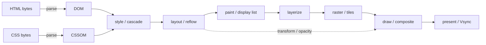

In the previous post, I told you that I want to build a browser engine from scratch using Swift. The initial step is building a rendering engine from scratch which is no WebKit. The starting point is using [Browser Engineering book](https://browser.engineering) created by awesome people: Pavel Panchekka & Chris Harrelson. Today, I would like to share to you my journey so far on how build this thing with misconception of **Everything is object**.

## Rendering Engine

What is rendering engine? It's an engine to turn the web page into pixel on the screen.

These orders are a whole process of rendering engine.

- **Parse HTML (bytes -> DOM)** HTML bytes from the network are decoded into text, split into tokens, and then assembled into a DOM tree. The parser also fixes the broken HTML, for example by put `<tbody>` or closing tags `</tbody>` into `<table>` tag that were left open.
- **Parse CSS (bytes -> CSSOM)** CSS bytes from (`<style>`, `<link>`, or the `style` attribute) are parsed into a list of rules made up of selectors and declarations, called the **CSSOM**. This happens in parallel with building the DOM.
- **Style** (style calculation): combines the DOM and the CSSOM. The browser matches every selector against the DOM nodes, then computes each element's final *computed style* (cascade, inheritance, specificity). The result: every node knows its `color`, `display`, `font-size`, and so-on.
- **Layout** (reflow): computes **geometry**. It means the x/y position, width and height of every box, based on the box model, flexbox, grid, and text wrapping. The result is a *layout tree* or *fragment tree*.
- **Paint**: builds a **list of drawing commands** (a *display list*), for example "draw a red box at (10, 20)" followed by "draw the text 'Hello' on top of it". There are no pixels yet at this stage, only instructions in the correct z-order.
- **Layerize**: splits the display list into multiple **layers**. Elements with `transform`, `opacity`, `will-change`, `video`, or scrolling areas usually get their own layer. The goal is that a change to one layer doesn't force the other layers to be redrawn.
- **Raster**: executes the display list of **each layer** into actual pixels (a bitmap). This work is usually split into *tiles* and often done on the GPU.
- **Draw / Composite**: the compositor **assembles the already-rasterized layers** into one final frame, applying transform, opacity, and scroll position along the way. This usually runs on separate thread or on the GPU. `transform` and `opacity` animations can jump straight to this stage without repeating layout, paint, and raster.
- **Present**: the final frame is sent to the screen, synchronized with **Vsync** (the monitor's refresh rate, e.g. 60 Hz ≈ 16 ms per frame) to prevent *tearing*.

**REMINDER**: A browser is more than its engine.

| Part | Job |
|---|---|
| Browser UI / chrome | tabs, address bar, window, input routing |
| Rendering engine | HTML/CSS/JS integration, DOM, style, layout, paint, compositing hand-off |
| Script engine | JavaScript execution (JSC/V8/SpiderMonkey) |
| Networking / storage | fetch, cache, cookies, origins |
| OS compositor / display | window animation, final composition, display timing |
