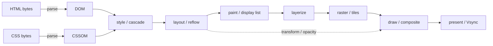
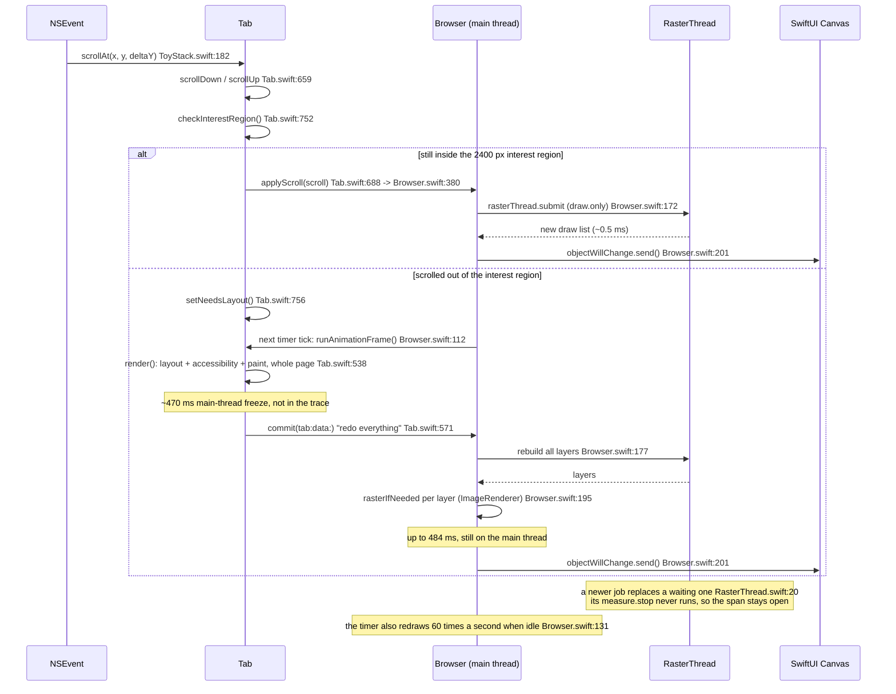
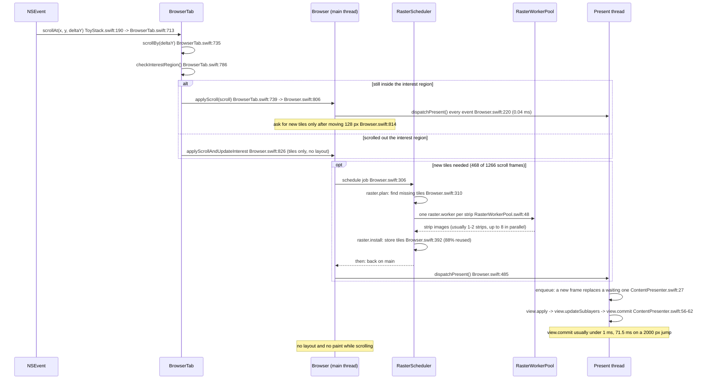
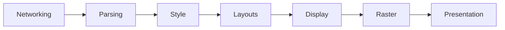

In the previous post, I told you that I want to build a browser engine from scratch using Swift. The initial step is building a rendering engine from scratch which is no WebKit. The starting point is using [Browser Engineering book](https://browser.engineering) created by awesome people: Pavel Panchekka & Chris Harrelson. Today, I would like to share to you my journey so far on how build this thing especially rendering engine with misconception of **Everything is object**.

## Impression

Building browser engine with AI is harder than I think. The harder parts are I **must** learn lot of terms in browser engineering, I need to re-read again and again to understand what it means and what's going on. If I just let AI write the code it means I don't learn as one of Richard Feynman's popular quote:

> What I cannot create, I do not understand.

Or if I want to modify the quote maybe like this:

> What I don't write, I do not understand.

## Rendering Engine

Let's fill our knowledge about rendering engine.

What is rendering engine? It's an engine to turn the web page into pixel on the screen.

These orders are a whole process of rendering engine.



- **Parse HTML (bytes -> DOM)** HTML bytes from the network are decoded into text, split into tokens, and then assembled into a DOM tree. The parser also fixes the broken HTML, for example by put `<tbody>` or closing tags `</tbody>` into `<table>` tag that were left open.
- **Parse CSS (bytes -> CSSOM)** CSS bytes from (`<style>`, `<link>`, or the `style` attribute) are parsed into a list of rules made up of selectors and declarations, called the **CSSOM**. This happens in parallel with building the DOM.
- **Style** (style calculation): combines the DOM and the CSSOM. The browser matches every selector against the DOM nodes, then computes each element's final *computed style* (cascade, inheritance, specificity). The result: every node knows its `color`, `display`, `font-size`, and so-on.
- **Layout** (reflow): computes **geometry**. It means the x/y position, width and height of every box, based on the box model, flexbox, grid, and text wrapping. The result is a *layout tree* or *fragment tree*.
- **Paint**: builds a **list of drawing commands** (a *display list*), for example "draw a red box at (10, 20)" followed by "draw the text 'Hello' on top of it". There are no pixels yet at this stage, only instructions in the correct z-order.
- **Layerize**: splits the display list into multiple **layers**. Elements with `transform`, `opacity`, `will-change`, `video`, or scrolling areas usually get their own layer. The goal is that a change to one layer doesn't force the other layers to be redrawn.
- **Raster**: executes the display list of **each layer** into actual pixels (a bitmap). This work is usually split into *tiles* and often done on the GPU.
- **Draw / Composite**: the compositor **assembles the already-rasterized layers** into one final frame, applying transform, opacity, and scroll position along the way. This usually runs on separate thread or on the GPU. `transform` and `opacity` animations can jump straight to this stage without repeating layout, paint, and raster.
- **Present**: the final frame is sent to the screen, synchronized with **Vsync** (the monitor's refresh rate, e.g. 60 Hz ≈ 16 ms per frame) to prevent *tearing*.

**REMINDER**: A browser is more than its engine.

| Part | Job |
|---|---|
| Browser UI / chrome | tabs, address bar, window, input routing |
| Rendering engine | HTML/CSS/JS integration, DOM, style, layout, paint, compositing hand-off |
| Script engine | JavaScript execution (JSC/V8/SpiderMonkey) |
| Networking / storage | fetch, cache, cookies, origins |
| OS compositor / display | window animation, final composition, display timing |

## What We Have Now?

In real-world, we as end-users use these browsers: Google Chrome, Safari, Firefox, Opera, Brave, Microsoft Edge.

> No IE! You're done. Rest in peace.

These browsers have their own rendering engine. Some of them using the a giant rendering engine.

- Blink: Google Chrome, Opera, Brave, Microsoft Edge
- WebKit: Safari
- Gecko: Firefox

There's also another rendering engines like Servo and LibWeb by Ladybird.

The thing that I would like to highlight is they are build with C/C++ and Rust. I wonder if I can make a rendering engine from scratch by using another programming language. Then, I pick Swift as my choice.

## Why Swift?

1. I'm using macOS. It's ridiculous if I never touch Swift programming language when I'm using macOS. Although, I'm using base model of MacBook Air M1, it should not be a gap to prevent me to use this language.

2. Saving my time with GUI (Graphical User Interface). In the end, the browser used by end-user is a desktop application. By using macOS and Swift, I have access to Apple GUI library like AppKit and Swift.

3. Curiosity. Previously, I mentioned about LadyBird. It's a new web browser written by scratch and truly independent. The truly independent means no interference from hands of giant corporations like Google. In 2024, the LadyBird team trying to replace C++ with Swift. But, the experiment failed because Swift support for C++ interopt doesn't meet their expectation and platform support outside Apple ecosystem was limited. So, here I go to try it again and who knows I learn things. :D

## Starting Point

I have follow along the practical guide from Browser Engineering and it turns to be a repository called Brownie (Browser Engineering). It used Python programming language as illustrated in the book. I start it from October 2025 and finish it in April 2026.

When I'm porting the code program into Swift, I split it into 4 parts (branches):

- Part 1 - branch `ch01-10`: It covers chapter 1 to 10 (Downloading Web Pages to Keeping Data Private)
- Part 2 - branch `ch11-14`: It covers chapter 11 to 14 (Adding Visual Effects to Making Content Accessible)
- Part 3 - branch `ch15`: It covers chapter 15 (Supporting Embedded Content)
- Part 4 - branch `ch16`: to 16 (Reusing Previous Computation)

Of course I'm using AI. For part 1 and 2, I use Claude Sonnet and Opus as assistance. I write the code that generated from AI instead of AI write the code by itself. Why? At least I want to make an effort to learn the syntax and behavior of Swift because I'm newbie in Swift programming. Of course, I prohibit myself to put any Swift third-party dependencies to build the rendering engine. :)

## Rendering Engine Responsibilities

Rendering engine has lot of responsibilities. Here's the list:

- **Frame scheduling**: decides when to make a new frame (the "rendering loop" or "even loop"), at most once per Vsync. It groups many changes into one frame and runs `requestAnimationFrame` callbacks before style and layout.

- **Scrolling**: moves the viewport over content that's already laid out. A good engine scrolls in the compositor by shifting the layer, without new layout or paint. That's why scrolling can stay smooth while the main thread is busy.

- **Viewport/resize handling**: when the window size changes, layout runs again for the new width, then paint and raster. This is **the most expensive path**, so it has to be throttled to the frame rate.

- **Invalidation (incremental updates)**: tracks what is "dirty" after a change (DOM edit, style change, resize) and redoes only that part of style, layout, or paint instead of the whole page.

- **Hit testing and input events**: turns a click, tap, or key press at (x, y) into the right DOM element using layout tree. It then dispatches the event (`click`, `input`, focus, link navigation).

- **Script integration (DOM bindings)**: gives the script engine an API to read and change the DOM (`querySelector`, `innerHTML`, event listeners). Every change feeds back into invalidation. The JS engine runs the code; rendering engine owns the DOM it touches.

- **Text and fonts**: load fonts, measures text, and shapes and breaks it into lines during layout.

- **Animations and visual effects**: handles `transform`, `opacity`, blending, clipping, and CSS transition, running them in the compositor when possible.

- **Embedded content**: decodes images and lays out and paints `<iframe>`s as nested documents with their own frames.

- **Accessibility tree**: builds a parallel tree from the DOM and layout so screen readers can read the page.

- **Security boundaries**: enforces same-origin rules for scripts and iframes, together with networking layer.

In this post, I will discuss about the two hard things I'm facing on in rendering engine: scrolling and resize handling.

## First Challenge: Smooth Scrolling

Given video side by side: the left side is bad scroll and the right side is good scroll.

<lite-youtube videoid="LfeJ1Hru42s" title="Bad Scroll vs Good Scroll"></lite-youtube>

In fps (frame per second) measurement, the bad scroll achieves 20 fps and good scroll achieves 52 fps. It increased 2.6x than the bad scroll. You may wondering why the bad scroll happened and how come I improve it. Before that, let me introduce you some glossaries.

| Word | Meaning |
| ---- | ------------ |
| frame | one new picture shown on the screen |
| fps | frames per second |
| gap | time between two frames; a long gap is a visible freeze |
| median | the middle value: half of the values are smaller, half are bigger |
| 95th percentile | 95% of the values are smaller than this — "how slow the slow cases are" |
| main thread | the one thread that handles clicks, keys and scrolling; if it is busy, the app freezes |
| worker thread | an extra thread that does heavy work so the main thread stays free |
| tile | a 128 × 128 px square piece of the page, drawn once and reused |
| layer | a picture that macOS (Core Animation) can move around on screen without redrawing it |
| interest region | the part of the page the bad build has already drawn (2400 px tall) |

Now, let's jump to a sequence diagram.

**Bad scroll commit `e8da50c`**


**Good scroll commit `5377322`**



## Refactoring Smooth Scrolling

This is a side-effect of vibe-coding, you accepted every output from your model and don't set the safety rails. The result is the bad scroll and messed up code. Think like you see kraby patty but when you eat it then the taste like chumb bucket. YIKES!

### Separate Rendering Engine from SwiftUI

So, I take a look closer the code and I spot the first issue. The rendering engine is mixed up with SwiftUI. So, I put the two rules here: 

1. The rendering engine must be free from SwiftUI declaration. 
2. Make protocol to make rendering engine and SwiftUI communicate each other.

I introduced small protocol called `Renderer`. It has contract for fill a rect, draw text, save/restore state. Then, I make two implementations based on `Renderer` protocol: `CGRenderer` (Core Graphics, inside `Engine` directory) and `SwiftUIRenderer` (inside the app).

Thanks to this one change, now it unlocks to things:

1. **A headless browser CLI (`10e4fcd`)**. The engine can render a page to PNG with no window. Now I can *look* a frame without clicking around.
2. **The browser chrome moved out (`57a024e`)**. The address bar and tabs bar are app code, not engine code. Removing the `import` only split the engine from the UI framework; moving `Chrome` split it from the UI *logic*.

### Scroll Bugs Become Readable

Thanks to the first step, now the scroll code become readable. There are three problems: the two problems were there from the start; the third one caused by myself during the cleanup.

**The UI was redrawing for nothing**. Every frame told SwiftUI "something changed", even when nothing did. SwiftUI then re-ran the whole page drawing (~250 ms) and the main thread was stuck at about 4 visible updates per second ([`eb5cd01`](https://github.com/kresnasatya/ToyStack/commit/eb5cd0132a2866e0bc3dc158286c4f8551d5cabe#diff-5329dfe88160bce2fcb345f233dbcc30bd1dc5c1dc91e779c174b7ef54652ede)). The fix: only signal a change when the painted output actually changed.

**Scrolling ignored the trackpad**. Every wheel event moved the page a fixed 100 px and restarted a scroll animation. Now the real trackpad delta is used, and scrolling inside a scroll container repaints without running style and layout (`64cea66`).

**The cleanup broke scrolling**. Before the cleanup, `Transform` moved the drawing by `+t`, drew its children, then moved back by `-t`. When it switched to `Renderer` protocol (`2242392`), it replaced that pair with save/restore, and got it wrong:

```swift
if let t = translation {
    renderer.saveState()
    renderer.translateBy(x: t.x, y: t.y)
}

// ...draw children...
renderer.restoreState() // runs even when nothing was saved.
```

Every block on the page is wrapped in a `Transform`, and most have no translation, so most restores undid a state that some *other* code had saved. The SwiftUI renderer hid this: restoring with nothing saved did nothing. To fix it just move one line, so every restore has a matching save:

```diff
+ renderer.saveState()
if let t = translation {
-   renderer.saveState()
    renderer.translateBy(x: t.x, y: t.y)
}
```

> **Note**: If I tell AI to put a test for `Transform`, I bet this problem will never appear.

### Too Much Arguments

The first scroll fixes worked, but they piled more arguments onto already crowded functions:

```swift
func rasterIfNeeded(scale: CGFloat, store: TileStore, hintTop: CGFloat, hintBottom: CGFloat, visibleTop: CGFloat, visibleBottom: CGFloat, budget: RasterBudget, visibleOnly: Bool = false)
```

Oh, also there's a class called `CommitData` that holds 13 arguments. Some of the arguments turned out to be dead.

```swift 
class CommitData {

    init(
        url: WebURL, scroll: CGFloat, height: CGFloat, layoutHeight: CGFloat, 
        maxScroll: CGFloat, displayList: [Any],
        compositedUpdates: [ObjectIdentifier: VisualEffect]?, 
        accessibilityTree: AccessibilityNode?,
        focus: DOMNode?, interestTop: CGFloat, 
        paintEpoch: Int, prefersDark: Bool, forcedColors: Bool,
    ) {}
}
```

I paused for a moment and then I say "What the hell!?"

First, that function contains 8 arguments. 
Second, if I keep continue then, it can be grow up into more than 8. 
Third, I don't know which of these values belongs to.

So, I put an idea by set maximum accepted parameters in a function is 4 parameters. Also, maximum properties are stored in a struct is four 4 parameters.

> Psst... This idea come from declaration of margin and padding in CSS. The margin and padding have 4 properties: top, right, bottom, left.

Thanks to this approach, these arguments are shrinked and become like this:

```swift
struct RasterWindow {
    public var CGFloat hintTop
    public var CGFloat hintBottom
    public var CGFloat visibleTop
    public var CGFloat visibleBottom
}

func rasterIfNeeded(scale: CGFloat, store: TileStore, window: RasterWindow, budget: RasterBudget, visibleOnly: Bool = false)
```

You may see the commit [`d348182`](https://github.com/kresnasatya/ToyStack/commit/d3481829dc1523d91a31606b84b18f69450bf2ff) for detail refactoring.

### Make The Scroll Fast, With Numbers

Now the code become readable enough to measure. Each performance commit from here on carries a measurement.

**Make tiles instead of one big picture (`e3d397c`)**. The page is split into 128x128 tiles, each its own Core Animation layer. A pure scroll only moves the container; the CPU draws only tiles that come into view.

**Effects on their own layers (`42e7e7c`, `b60d384`)**. Pages with opacity, blur, transforms, or blend modes still redrew the whole window. Now they get their own layers, tiles are cached, and tile jobs are batched across layers.

**Separate the planner from the painters (`33d1b6e`)**. One queue was both deciding *what* to draw and *drawing* it, and it blocked until every pixel was done. Now a scheduler plans on one queue and a fixed pool of 4 workers paints.

**A sort hiding in the cache (`1d60e3a`)**. The tile cache sorted all entries on every insert to find the oldest one. While scrolling, the cache sits right at its limit, so it sorted once per tile.

**Get off the main thread (`eda4d1a`)**. Updating layers and committing them happened on the main thread. A new `ContentPresenter` does it on its own queue and keeps only the latest frame if several pile up.

**Tweak style and layout before painting (`1709920` -> `bd197b7`)**. The engine matches CSS rules to elements (style) and measures text to place words on lines (layout). The AI added trace spans and counters for these steps (`1709920`, `f3bb081`): how many elements x rules style had to check, and how many times layout measured a word. From there, AI make fixed based on trace result:

A. Remember text measurements instead of measuring the same word again (`1247311`)

B. Look up the font once per text node instead of once per word. A text node is a run of text between two tags, and all its words share one style, so they share one font (`1247311`, `c5413f3`, `bd197d7`).

Example:

```html
<p>The quick brown fox <b>jumps over</b> the lazy dog</p>
```

| Text Node | Style | Words that layout cuts it into |
|---|---|---|
| "The quick brown fox" | normal | The, quick, brown, fox |
| "jumps over" | bold (inside <b>)  | jumps, over |
| " the lazy dog" | normal | the, lazy, dog |

C. Group CSS rules by tag, class, and id. So, an element is only checked against rules that could match it (`9aea139`).

D. Skip a rule like `nav a` right away when the element has no `nav` above it (`5b90ad6`).

### Organize, Organize, Organize

This step rename some files with reasonable reason and organize files into domain.

| Before | After | Reason |
|---|---|---|
| `RasterThread` | `RasterScheduler` | It schedules; it is not a thread |
| `NetworkingThread` | `NetworkTaskRunner` | Same reason |
| `Tab` | `BrowserTab` | Collided with `SwiftUI.Tab` |
| `CommitData` | `FrameCommit` | What a frame hands over |
| `FrameEpoch` | `FrameRevision` | It counts revisions |
| `ThemeState` | `ColorPreferences` | It is the user's color preferences |
| `StyleContext` | `MediaFeatures` | Matches the CSS term |
| `ScrollAnimation` | `ScrollTween` | It tweens between two values |
| `animate()` | `nextValue()` | Says what it returns |
| `splitTopLevel` | `splitOutsideParentheses` | Says what it does |

The files organized into a folder based on domain that follow the order a web page is built:



The `Core` domain for orchestrates. The `Animation` pushes new style values into the line every frame. `Accessibility` reads the laid-out page and adds highlight outlines to the drawing. `Platform`, `Scheduling`, `Diagnostic` used for support. 

With this approach, when something went wrong like "Tile shows wrong text, color, or position" or "Tile is black, stale or missing" or "Tile content is right but sits in the wrong place on screen" then you may know which folder to open.

> **Note**: For the case "Tile shows wrong text, color, or position", you need to look `Display` (draw list), `Layouts` (positions), or `Style` (CSS values). For the case "Tile is black, stale or missing", you need to look `Raster` directory which contains cache key, which tiles get painted, the worker pool. For the case "Tile content is right but sits in the wrong place on screen", you need to look `Presentation` and `ContentPresenter`.

## Second Challenge: Smooth Resize Window

### Refactoring Part 2

## Benefit of Using Swift

### ARC

### Swift UI

### Statically typed toolchain (?)